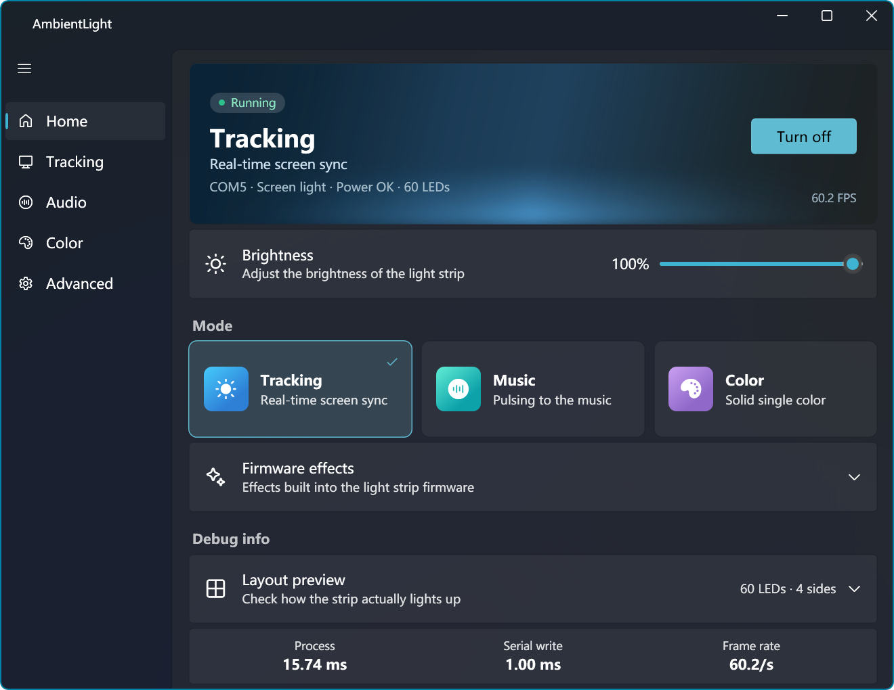

# AmbientLight

[English](/README.md) | [中文](/README_CN.md)

Let what's on your screen decorate your space, in real time. An open-source client for Ansnake screen-sync ambient light strips.

> ⚠️ Coding style warning: Vibe Coding Project.

## Features

### Nearly complete parity with the vendor client

- Screen sync, audio reactive, solid color, and firmware effects
- Multiple devices
- LED order offset calibration

### UI & performance

- Modern Fluent design
- Very low latency and system load (< 1% CPU/GPU), with unchanged frames skipped automatically
- No hardware telemetry reporting like the vendor app, and no ads
- Full exception handling, plus system-event listeners for display and power changes

### Quality-of-life improvements

- Smooth fade in/out when the strip is turned on or off
- Color mapping correction
- Flash suppression and temporal smoothing in screen-sync mode

## Screenshots



## Build

### Build from source

Install the [.NET 10 SDK](https://dotnet.microsoft.com/download/dotnet/10.0) and [Visual Studio](https://visualstudio.microsoft.com/vs/community/) with the MSVC compiler and Windows SDK included.

```bash
git clone https://github.com/icyray/ambient-light.git

cd ambient-light

dotnet build
```

### Build with GitHub Actions

Fork the repository and enable GitHub Actions, then pick the matching workflow under the Actions tab.

## TODO

- [ ] WGC capture backend
- [ ] Enhanced audio-reactive mode
- [ ] Custom effects
- [ ] More accurate color calibration
- [ ] ~~Windows Dynamic Lighting integration~~

## License

[MIT](LICENSE).
