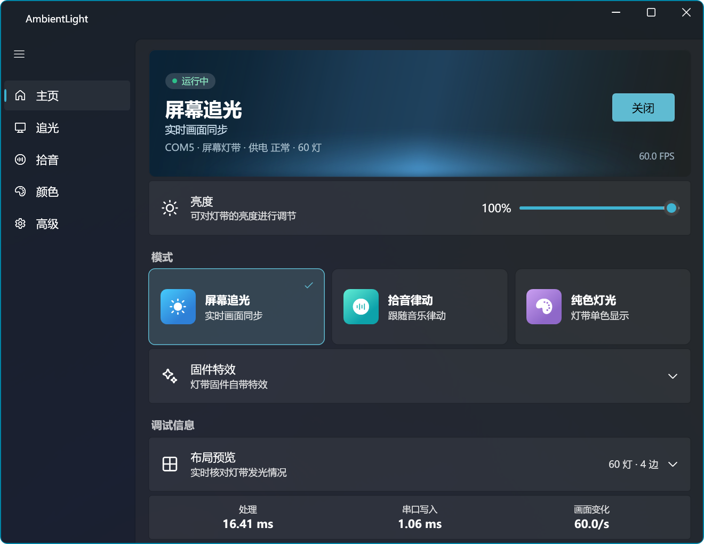

# AmbientLight

[English](/README.md) | [中文](/README_CN.md)

让屏幕画面内容动态装饰你的空间。适用于 Ansnake 屏幕追光氛围灯的客户端开源实现。

> ⚠️ Coding style warning: Vibe Coding Project.

## 特性

### 原厂功能基本完整实现

- 屏幕追光、拾音律动、纯色灯光、固件特效
- 支持多设备控制
- 支持灯序偏移校准

### 界面与性能

- 现代 Fluent 设计
- 极低的延迟与系统占用（ < 1% CPU/GPU 占用），自动跳过不变帧
- 无原厂的设备信息遥测监控上报，无广告
- 完整的异常处理与事件监听切换

### QOL 提升

- 开关灯淡入淡出平滑
- 颜色映射校正
- 追光场景下抑制闪光与时域柔和

## 截图



## 构建

### 从源码构建

安装 [.NET 10 SDK](https://dotnet.microsoft.com/download/dotnet/10.0)，[Visual Studio](https://visualstudio.microsoft.com/vs/community/)，并集成 MSVC 编译器、Windows SDK。

```bash
git clone https://github.com/icyray/ambient-light.git

cd ambient-light

dotnet build
```

### 使用 Action 构建

Fork 项目并启用 GitHub Actions，在 Actions 中选择对应 workflow。

## TODO

- [ ] WGC 后端
- [ ] 增强的拾音模式
- [ ] 自定义特效
- [ ] 更准确的颜色校准
- [ ] ~~Windows 动态光效接入~~

## 许可证

[MIT](LICENSE).
